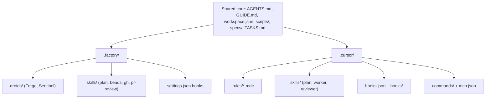

# Tooling: Factory.ai vs Cursor

This workspace ships adapters for two AI coding tools over **one shared core**. The playbook (`AGENTS.md`), task tracking, scripts, specs, and `workspace.json` are tool-agnostic and read by both. Only the *wiring* differs.

> `./scripts/init.sh` lets you keep just one adapter (it removes the other). You can also keep both.

## What's shared (tool-agnostic core)

| File / dir | Purpose |
|---|---|
| `AGENTS.md` | The playbook. Both Factory and Cursor read it automatically. |
| `GUIDE.md` | Human workflow guide. |
| `workspace.json` | Repo registry (siblings, default branches). |
| `scripts/` | `init`, `setup`, `sync`, `status`, `worktree`, `reset`. |
| `specs/` | Spec template + your specs. |
| `TASKS.md` | Markdown fallback tracker when `bd` is absent. |

## What's tool-specific

| Concern | Factory.ai | Cursor |
|---|---|---|
| Agent personas | `.factory/droids/*.md` with `model:` frontmatter (Forge = `cross-repo-worker.md`, Sentinel = `reviewer.md`) | `.cursor/skills/worker/` and `.cursor/skills/reviewer/`, dispatched as Task subagents |
| Skills | `.factory/skills/` (`plan`, `beads`, `gh`, `pr-review`) | `.cursor/skills/` (`plan`, `worker`, `reviewer`) |
| Persistent rules | `AGENTS.md` only | `AGENTS.md` + `.cursor/rules/*.mdc` (e.g. `workspace-core.mdc`, `alwaysApply: true`) |
| Session hooks | `.factory/settings.json` (`SessionStart`/`PreCompact` -> `bd memories`) | `.cursor/hooks.json` + `.cursor/hooks/load-memories.sh` (`sessionStart`/`preCompact`) |
| Slash commands | n/a (invoke skills by name) | `.cursor/commands/` (`/plan`, `/work`, `/review`) |
| MCP integrations | Configured in Factory | `.cursor/mcp.json` |
| Model selection | Droid `model:` frontmatter | Cursor model picker / Task `model` arg |



## Using with Factory.ai

1. Keep `.factory/` (run `./scripts/init.sh` and choose Factory, or just leave both).
2. Set droid models in `.factory/droids/cross-repo-worker.md` and `.factory/droids/reviewer.md` (the `model:` frontmatter — `init.sh` can fill these from `--worker-model` / `--reviewer-model`).
3. Open the workspace in Factory. Droids and skills are picked up from `.factory/`. The `SessionStart` hook loads `bd memories` when `bd` is installed.
4. Plan with: `plan <TICKET-KEY>` (or `plan: <idea>`).

## Using with Cursor

1. Keep `.cursor/` (run `./scripts/init.sh` and choose Cursor, or leave both).
2. Open the folder in Cursor. `.cursor/rules/workspace-core.mdc` applies automatically; skills load from `.cursor/skills/`.
3. The worker/reviewer personas are skills dispatched via the Task tool by the `plan` skill (or invoke `/work <id>` and `/review <id>` manually).
4. Optional: add an issue-tracker MCP server to `.cursor/mcp.json`, e.g.:
   ```json
   {
     "mcpServers": {
       "atlassian": { "url": "https://mcp.atlassian.com/v1/sse" }
     }
   }
   ```
5. Plan with: `/plan <TICKET-KEY>` (or just say `plan <TICKET-KEY>`).

## Keeping both

Both adapters are inert to the other tool (dotfolders), so keeping both is safe. The cost is only that each tool ignores the other's folder. Choose this if your team mixes tools across repos (e.g., iOS in Cursor, backend in Factory).
